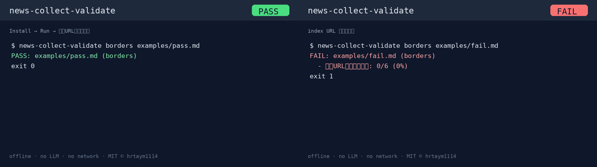

# news-collect-validate

ニュース収集 Markdown の「創作見出し／index URL 事故」を後工程に流さない、**オフラインの収集品質ゲート**。  
[x-jev-gate](https://github.com/hrtaym1114-github/x-jev-gate) の上流で使う小さな CLI です。

An offline quality gate for collected news Markdown (upstream of x-jev-gate).  
Flags index-page URL substitutions, low article-link ratios, repeated URLs, and too-few items. **No LLM, no network, no posting.**

[](docs/media/news-collect-validate-howto.gif)

- 🎞️ [GIF（PASS ↔ FAIL）](docs/media/news-collect-validate-howto.gif)
- Release: [v0.1.0](https://github.com/hrtaym1114-github/news-collect-validate/releases/tag/v0.1.0)

## 使い方（4ステップ）

1. **Install** — `pip install git+https://github.com/hrtaym1114-github/news-collect-validate.git`
2. **用意** — 収集済み Markdown（キー不要・完全オフライン）
3. **Run** — `news-collect-validate borders your.md`
4. **結果** — **PASS**（exit 0）/ **FAIL**（exit 1）

```sh
news-collect-validate borders examples/pass.md
# PASS: examples/pass.md (borders)

news-collect-validate borders examples/fail.md
# FAIL: examples/fail.md (borders)
#   - 記事URLの比率が低い: 0/6 (0%)。...
```

## Install / インストール

Python ≥ 3.10。実行時は標準ライブラリのみ。

```sh
# 見知らぬ人向け（推奨）
pip install git+https://github.com/hrtaym1114-github/news-collect-validate.git

# 開発（このリポ）
python3 -m venv .venv
. .venv/bin/activate
pip install -e '.[dev]'
pytest -q
```

LLM・ライブ取得・X投稿・ネットワーク通信は使いません。

## Run / 実行

```sh
news-collect-validate borders examples/pass.md
news-collect-validate borders examples/fail.md
news-collect-validate borders examples/pass.md --json
python -m news_collect_validate borders examples/pass.md
news-collect-validate trend --text '1. [Source](https://example.com/news/1234)' --json
# FAIL / exit 1: trend requires at least 10 items
```

PASS JSON の例:

```json
{"ok": true, "mode": "borders", "path": "examples/pass.md", "problems": [], "stats": {"articles": 6, "indexes": 0, "ratio": 1.0, "items": 6, "unique_articles": 6}}
```

`--text` のとき `path` は `null`。入力の欠落・空・不正 UTF-8・読み取り失敗も FAIL（fail closed）。

| Exit | Meaning / 意味 |
| --- | --- |
| 0 | PASS |
| 1 | FAIL: 検証または入力読み取り失敗 |
| 2 | CLI 引数エラー |

## Rules / 判定ルール

元の `validate-news-collection.py` から抽出。URL ヒューリスティック・しきい値・重複・件数フォールバックを維持しています。

- 数えるリンクはインライン Markdown の HTTP(S) `](https://...)` のみ
- index 扱い: 空 path、`/`、`/news`、`/news/`、`/aiplus`、`/aiplus/`、`/index.html`
- 記事 URL: index 以外で path が2段以上、または数字が4連続以上。HN 例外は host が正確に `news.ycombinator.com` かつ `id` クエリが2桁以上（path を `/item` に限定しない）
- 記事 URL 比率 **≥ 80%**（index は比率を下げる。index が1本あるだけでは必ずしも FAIL ではない）
- 記事 URL のユニーク率 **≥ 70%**（記事リンク出現数に対する）
- `borders`: 項目 **≥ 6**（`^\*\*.+\*\*$`、無ければ `🔗` 行）
- `trend`: 項目 **≥ 10**（`^\d+\. \[`、無ければリンク総数＝index 含む）

これは URL 形状のヒューリスティックであり、見出しの真偽や記事の実在は検証しません。  
サンプル見出しと example.com リンクはテスト専用です。

## Related

- 下流ゲート: [x-jev-gate](https://github.com/hrtaym1114-github/x-jev-gate)（X 下書きの PASS/BLOCK）

MIT © 2026 hrtaym1114
